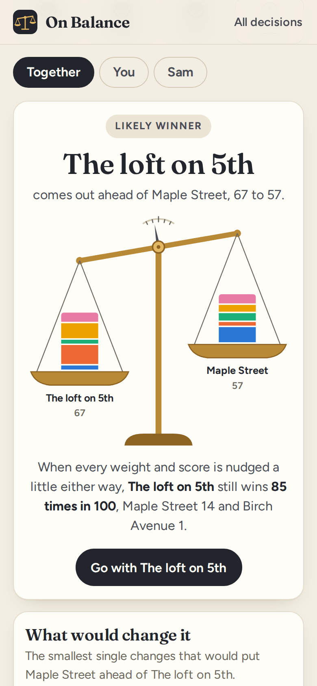
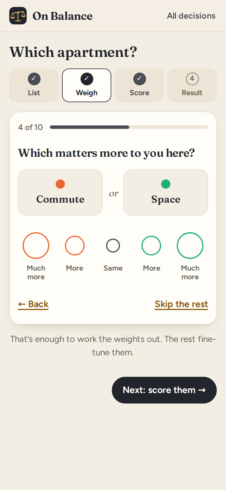
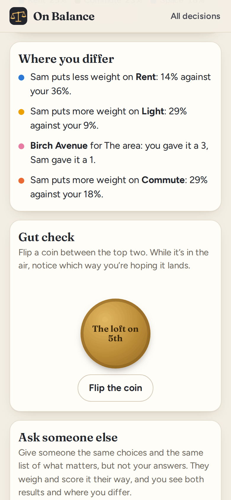

# On Balance

**Use it: [junkdrawer.works/on-balance](https://junkdrawer.works/on-balance/)**

**Weigh up a hard choice and see which way it tips.** List your choices and what matters to you, say which things matter more, and score each choice. On Balance puts the top two on a balance, tells you how sure you can be, and shows the smallest change that would tip it the other way. Send it to someone else and see where the two of you differ.

<p align="center">
  
  &nbsp;
  
  &nbsp;
  
</p>

## How it works

- **List** the choices (two to eight) and what matters (up to eight things). There are ideas to tap if you're stuck: cost, time, where it is, the people.
- **Weigh** what matters one pair at a time: "Which matters more to you here, Rent or Commute?", from much more to much more. The answers become a weight for each thing, worked out by least squares on the ratios, which is the usual way of turning pairwise comparisons into weights. Once your answers link everything up you can skip the rest. If some answers go round in a circle (Rent over Commute, Commute over Space, Space over Rent), it says so. Or set the weights by hand with sliders.
- **Score** each choice from 1 to 5 on each thing, or ✕ to rule it out, however well it does on everything else.
- **The result** puts the top two on a balance, each pan stacked with what every thing put in, tipped by how far apart they are. Under it:
  - **How sure you can be.** Every weight and score gets nudged a little a thousand times, and it counts how often the winner still wins. That gives Clear winner, Likely winner, Close call or Toss-up.
  - **What would change it.** The smallest single change that would put the runner-up ahead: one weight ("if Commute counted for 34% instead of 22%"), or one score ("if you'd given the loft a 3 for Rent instead of a 2").
  - **All the choices**, with a bar for each showing what made up its score, and why anything was ruled out.
  - **Gut check.** Flip a coin between the top two and notice which way you're hoping it lands. If your gut disagrees with the scores, something may be missing from the list.
  - **Go with it** marks the decision made, with the date.
- **Ask someone else.** Send a link with the same choices and the same list of what matters, but not your answers. They weigh and score it their way and send a link back. Open it and you get their result, yours, and the two together (weights averaged, and a ✕ from either of you rules a choice out), plus where you differ most. Or pass them your phone and their answers join yours when they're done.
- No account and no server. Your decisions stay in your browser, and links carry everything after the #, which browsers don't send anywhere. Save a backup to a file and load it on another device. It works offline and installs to a phone's home screen.

## Running it

It's a static site: plain HTML, CSS and JavaScript modules, with no build step.

```sh
npx serve .                   # or any static file server, then open the printed address
npm install                   # only for the tools below: esbuild and upng-js
npm test                      # the arithmetic and the links (Node 20+), then the real page in Chromium (needs Playwright)
node tools/screenshots.mjs    # redraws docs/*.png and og.png
node tools/make-icons.mjs     # redraws the PNG icons from icon.svg
npm run build                 # dist/on-balance.html, the whole app in one file
```

To put it online with GitHub Pages: **Settings → Pages → Build and deployment → Deploy from a branch**, then pick `main` and `/ (root)`.

### Files

- `js/model.js`: the arithmetic. Weights from the pair answers, totals, how sure (the nudging), what would change it, everyone's answers together, and where two people differ. No page code, so the tests run it in Node.
- `js/steps.js`: the List, Weigh and Score screens. `js/result.js`: the result, the coin and sharing.
- `js/scale.js`: draws the balance. `js/share.js`: packs a decision or a set of answers into a link and back.
- `js/app.js`: which screen goes with which address, the home screen, and opening shared links. `js/ui.js`: pieces every screen uses. `js/store.js`: saving in the browser, and backups. `js/examples.js`: the three examples.
- `fonts/`: Fraunces and Figtree, both under the SIL Open Font License, served from here so nothing loads from elsewhere.
- `sw.js`: keeps a copy for using offline.
- `test/unit.test.mjs` checks the arithmetic, including that every suggested change really does tip the result, across a few thousand random decisions. `test/e2e.mjs` makes a decision, asks someone on a second device, gets their answers back, passes the phone to a third person, and checks it works offline.
